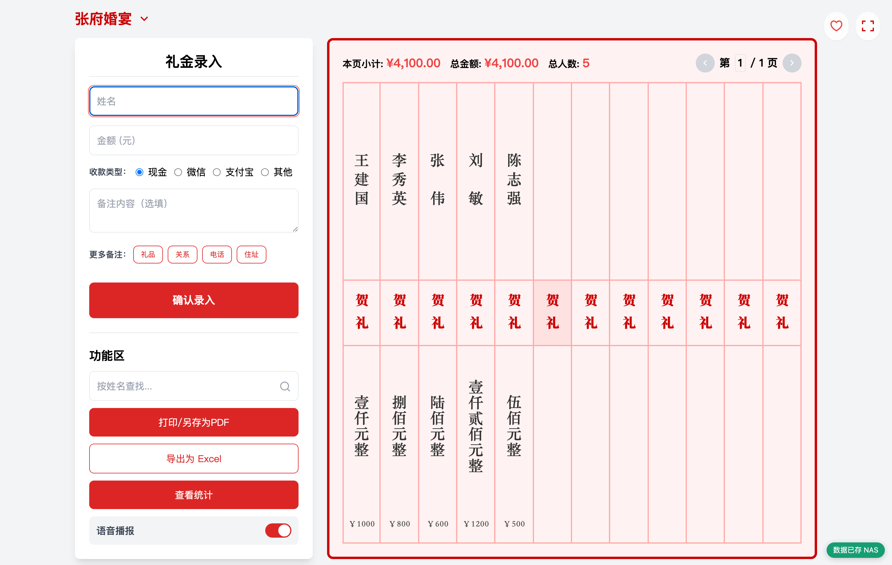

# 电子礼簿 · NAS 持久化版

> 在原版「纯本地单页应用」之上，补一个 NAS 端数据仓库：
> **数据落盘到自己的硬盘、多设备共享同一份礼簿、清缓存不丢数据**，同时保留原版「断网也能记账」的特性。

部署形态是一个 Docker 容器（前端 + 后端同源），挂到自己的 NAS / 服务器 / 迷你主机上就能用。



---

## ⚠️ 二开声明与开源许可（请先读这段）

本项目是 **[jingguanzhang/gift-book](https://github.com/jingguanzhang/gift-book)（「电子礼簿系统」）的二次开发版本，不是原创项目。**

| 事项 | 说明 |
|---|---|
| 前端代码 | 来自原项目，版权归原作者所有 |
| 开源许可 | 原项目采用 **CC BY-SA 4.0**（署名—相同方式共享），本项目作为其衍生作品**沿用同一许可** |
| 原作者声明 | 原项目「仅供个人学习、研究或自用，严禁任何形式的商业转售」的声明，本项目**一并遵守** |
| 上游原文 | 完整保留在 [`src/UPSTREAM-README.md`](src/UPSTREAM-README.md) 与 [`src/License`](src/License) |

**本项目新增 / 修改的部分**：NAS 持久化后端 [`server.py`](server.py)、前端数据层改造（`HybridDBManager` / `RemoteDBManager`）、安全加固与部署配套。

如果你要用这个项目，请同样遵守 CC BY-SA 4.0：**署名原作者 + 以相同协议开源**。

---

## 相比原版多了什么

| 能力 | 原版 | 本版 |
|---|---|---|
| 数据存放 | 只存浏览器 IndexedDB | 浏览器 + NAS 硬盘（**以 NAS 为准**） |
| 换设备打开 | 各存各的，互相看不到 | 打开就是同一份礼簿 |
| 清了浏览器缓存 | 数据没了 | 自动从 NAS 拉回来 |
| NAS / 网络挂了 | —— | 自动降级为本地模式，**照样能记账**，恢复后自动回传 |
| 数据备份 | 手动导出 | 每次写入自动留上一版 `.bak`，另有手动快照 |
| 并发写入 | 不适用 | 服务端统一分配 `id`，多设备不冲突 |
| 部署 | 纯静态托管 | 单个 Docker 容器 |

原版的功能一个没少：AES-256 加密、中文大写、语音播报、双屏互动、Excel/PDF 导出、喜庆红 / 肃穆灰双主题。

---

## 快速开始

```bash
git clone https://github.com/bestmingyang/gift-book-nas.git
cd gift-book-nas

# 启动（前端 + 后端 + 数据目录一次到位）
docker compose up -d
```

然后浏览器打开 `http://<宿主机IP>:8094` 即可。

> 首次启动会自动创建数据文件；`data/` 目录默认就在项目旁边，想放到 NAS 大容量盘上，改 `docker-compose.yml` 里那行数据卷路径即可。

**停止 / 升级**

```bash
docker compose down          # 停止（数据保留）
docker compose up -d --build # 更新后重启
```

---

## 配置项

在 `docker-compose.yml` 的 `environment` 里调整：

| 环境变量 | 默认值 | 说明 |
|---|---|---|
| `GB_DATA_DIR` | `/data` | 数据落盘目录（容器内路径） |
| `GB_STATIC_DIR` | `/home/static` | 网页目录（容器内路径） |
| `GB_PORT` | `3000` | 容器内监听端口 |
| `GB_TOKEN` | 空 | 访问口令。**留空 = 不鉴权**；设置后所有 `/api/*` 需携带 `X-GB-Token` 请求头 |
| `GB_MAX_BODY` | `2097152` | 单次请求体上限（字节），默认 2MB |
| `TZ` | `Asia/Shanghai` | 时区，影响日志与备份文件命名 |

### 关于访问口令

- **局域网自用**：留空即可，打开链接就能用。
- **一旦要做内网穿透 / 暴露到公网**：务必设置 `GB_TOKEN`，例如
  ```yaml
  - GB_TOKEN=换成你自己的随机字符串
  ```
  还可以用带口令的链接免手动输入（打开后自动从地址栏抹除并记住）：
  ```
  http://<地址>:8094/?token=<口令>
  ```

---

## 数据放在哪

所有数据落在 `GB_DATA_DIR` 下面：

| 文件 | 说明 |
|---|---|
| `giftbook-db.json` | 主库（全部事项 + 礼金） |
| `giftbook-db.json.bak` | 上一次写入前的自动备份 |
| `snapshots/` | 执行 `/api/restore` 前的自动快照 |

写入采用 **「写临时文件 + 原子替换」**，避免断电或中断把库文件写坏。

**备份建议**：直接把整个 `GB_DATA_DIR` 目录丢进你的 NAS 同步 / 快照任务即可；也可以访问 `GET /api/export` 手动下载完整库文件。

---

## 它是怎么工作的

```
浏览器（src/index.html）
  └─ HybridDBManager          ← 唯一的数据门面
       ├─ RemoteDBManager  →  fetch /api/*        【首选】数据写到 NAS
       └─ DBManager        →  IndexedDB           【降级】离线缓存 / NAS 不可用时兜底
  └─ 副屏 guest-screen.html   ← 通过 postMessage 从主窗口收数据（无需改动）

NAS（server.py，单进程，零第三方依赖）
  ├─ 静态文件服务   /        →  /home/static
  └─ 数据接口       /api/*   →  /data/giftbook-db.json
```

改造的关键点是：原版所有数据读写都经过 `GiftRepository` 这一个门面，所以只需把数据层换个实现、入口改 1 行，其余业务代码（含副屏）完全不用动。

**离线回传机制**：记录会带一个全局唯一 `uid` 和显式的「待同步」标记。NAS 恢复连接后按 `uid` 判断该新增还是更新，再把礼金重新挂到正确的事项下——这样即使本地和 NAS 两边的自增 `id` 撞号，也不会丢数据。

### 接口一览

```
GET    /api/health             健康检查 + 统计
GET    /api/events             全部事项
GET    /api/events/<id>        单个事项
POST   /api/events             新增事项 -> {"id": n}
PUT    /api/events/<id>        更新（不存在则插入）
DELETE /api/events/<id>        删除（级联删除其下礼金）
GET    /api/gifts              全部礼金（可用 ?eventId= 过滤）
GET    /api/gifts/<id>         单条礼金
POST   /api/gifts              新增礼金 -> {"id": n}
PUT    /api/gifts/<id>         更新
DELETE /api/gifts/<id>         删除
GET    /api/export             下载完整库文件（JSON）
POST   /api/restore            用上传的 JSON 全量覆盖（灾难恢复）
```

---

## 数据安全

- **服务端看不到明文**：姓名的金额在浏览器端用 **AES-256** 加密后才提交，NAS 上存的是密文。密钥就是你的管理密码，**服务端不保存密码、也无法解密**——硬盘被拷走也读不出内容。
- **明文的部分只有排序索引**：`guestLevelWeight` / `levelUpdateTime` 用于排序，不含姓名金额。
- **访问口令**：`GB_TOKEN` 保护所有数据接口。
- **已做的加固**：访问鉴权、移除 CORS 通配、路径穿越防护、请求体大小上限、存储型 XSS 转义、`HEAD` 长连接规范化。
- **零外部依赖**：页面全部资源本地自包含，**断掉外网也能正常使用**。

---

## 已知限制

- **没有用户体系**：单库单口令，所有知道访问口令的人看到的是同一份礼簿。
- **无跨设备实时推送**：同一台机器的副屏是实时的（走 postMessage）；手机录入后，另一台设备需要手动刷新页面。
- **数据文件权限受文件系统限制**：如果数据目录挂在 NTFS-3G 之类的文件系统上，`chmod` 不生效，无法进一步收紧权限。
- **全量 JSON 落盘**：每次写入都要重写整个库文件，写入成本随数据量线性增长。一场喜事几百条完全无感；上万条建议自行换成 SQLite。

---

## 目录结构

```
gift-book-nas/
├── docker-compose.yml        # 一键部署
├── server.py                 # NAS 持久化后端（Python 标准库，零依赖）
├── src/                      # 前端
│   ├── index.html            # 主程序（原版 + 数据层改造）
│   ├── guest-screen.html     # 副屏展示页
│   ├── UPSTREAM-README.md    # 上游原版说明（保留署名）
│   ├── License               # 上游许可证原文
│   └── static/               # 第三方库与字体（原版自带）
├── data/                     # 数据目录（运行时生成，已 gitignore）
└── LICENSE                   # CC BY-SA 4.0
```

---

## 致谢

- 前端应用与整体设计的原作者：**[jingguanzhang](https://github.com/jingguanzhang)**（[gift-book](https://github.com/jingguanzhang/gift-book)）
- 原版内使用的开源库：crypto-js、pdf-lib、fontkit、SheetJS、Grid.js、Pell、Remix Icon、Tailwind CSS、Mermaid
- 字体：Ma Shan Zheng、Noto Sans SC、Source Han Serif CN

## 许可

本项目沿用上游许可 **[CC BY-SA 4.0](LICENSE)**（Creative Commons Attribution-ShareAlike 4.0 International）。

你可以自由使用、修改、分发，但必须：**① 署名原作者；② 以相同协议开源你的衍生作品。**
